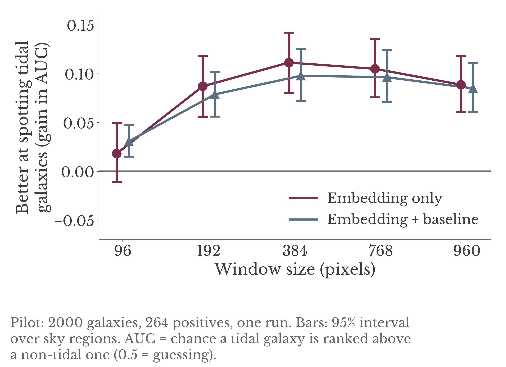
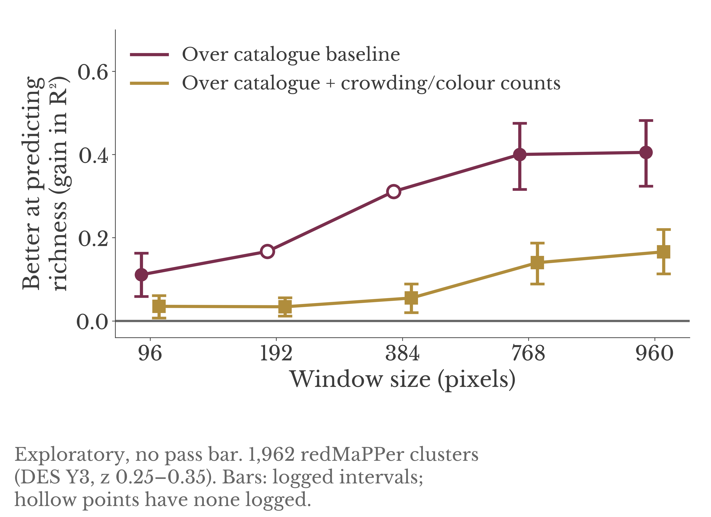
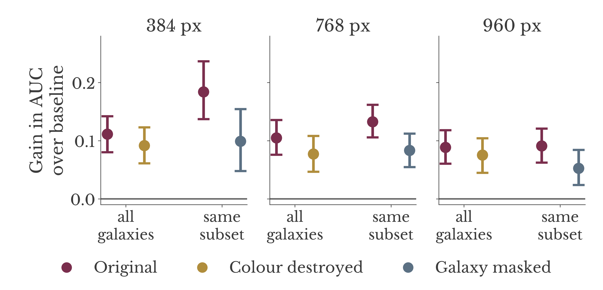
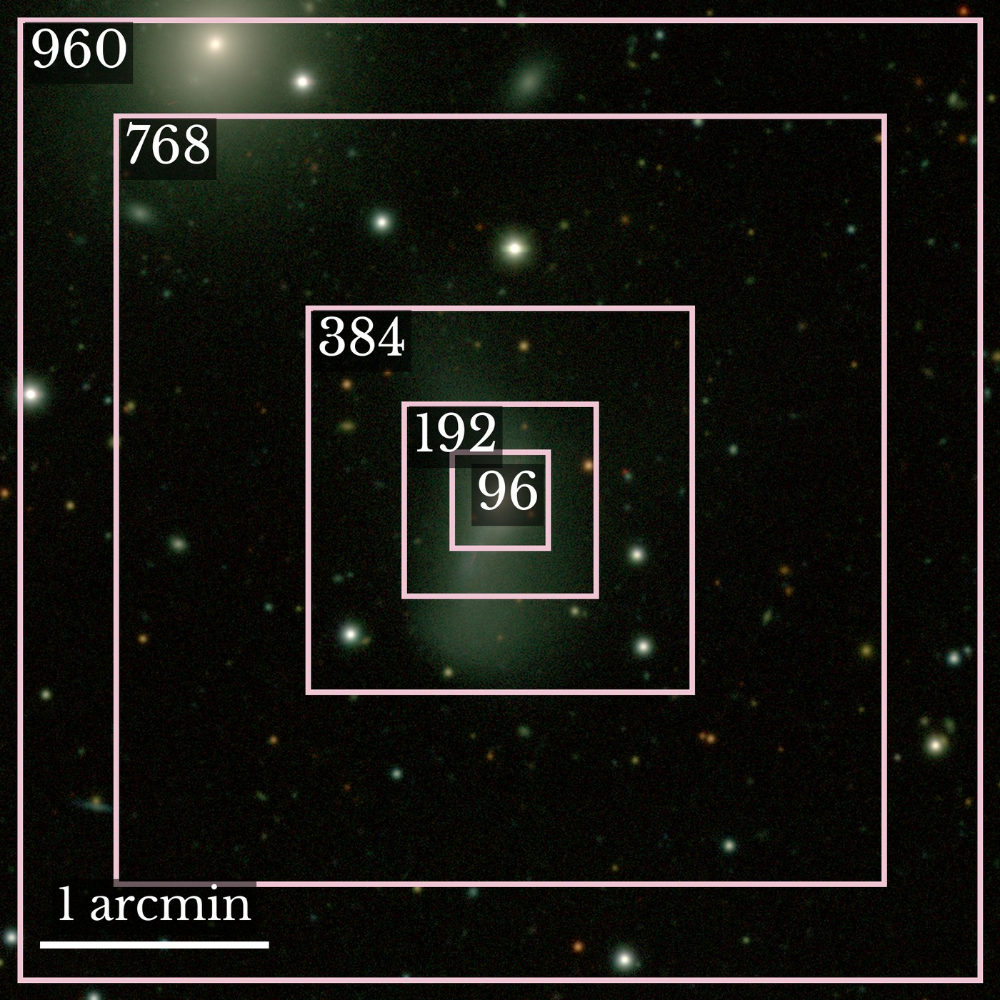

<!-- DRAFT: remove this block before publishing.
Remaining TODOs:
 1. Add the STRRINGS data link (see the paper's data-availability section) in "Data and acknowledgements".
 2. Check the redMaPPer link is the source you actually used.
 3. Add the repo URL to the poster QR code.
-->

# Build or Adapt? Tests of foundation models on survey tiles

Poster for the Center for Decoding the Universe (C4DU) Fall Forum, November 9, 2026.
Ana Inés Ennis, Stanford. Contact: anaennis@stanford.edu

Survey images arrive as wide tiles, with objects anywhere in them. Before building a tile-native foundation model, we asked whether a general-purpose vision model (DINOv3), used frozen or with a small adapter, can get most of the way, using an astronomy-specific model (AION-1) as the benchmark. This repo holds the figures from the poster, the small tables behind them, and the details that did not fit on it.

## The short version

- **Single objects (earlier work).** A lightweight adapter on DINOv3 closed about 50-60% of the gap to AION-1 on centred brightness and colour. Neither met our accuracy bars. Under the decision rule we wrote down beforehand, the outcome was an "adapter ceiling", which says a from-scratch test might be worth running. It is not a decision to build.
- **Wider windows (follow-on pilot).** We then asked whether giving a frozen DINOv3 a wider window around each object helps, beyond what cheap baselines already explain.
  - **Cluster richness** (exploratory): wider windows predict richness much better than catalogue properties alone, but a cheap colour-and-crowding counter reproduces about two-thirds of that gain at 768 px.
  - **Tidal features** (no cheap counting recipe): from 192 px up, the embedding beats a catalogue-plus-simple-image-features baseline by about +0.08 to +0.11 AUC, with no clear change from 192 to 960 px.

## Figures

| | |
|---|---|
|  |  |
| Tidal features: gain over the baseline, by window size | Cluster richness: gain over two baselines |
|  |  |
| Tidal gain with colour destroyed, or the galaxy masked | The windows tested, on one example galaxy |

`figures/tidal_gain_ap.png` is the same as the first figure in average precision (AP). Windows image: Legacy Surveys / D. Lang (Perimeter Institute), [CC BY 4.0](https://creativecommons.org/licenses/by/4.0/).

## Part 2: do wider windows help?

### Method (tidal features)

- **Model.** DINOv3 ViT-B/16 (`facebook/dinov3-vitb16-pretrain-lvd1689m`), frozen, no adapter.
- **Input.** A centred square crop of W pixels from a 1000 px Legacy Survey cutout (0.262 arcsec/px), at native scale with no resizing. g, r, z are asinh-stretched into RGB and ImageNet-normalised. W = 96, 192, 384, 768, 960 px, i.e. 25 to 252 arcsec.
- **Embedding.** The mean of the patch tokens (not the class token or the 4 register tokens): 768 numbers per window.
- **Sample and labels.** 2000 galaxies from the Siena Galaxy Atlas (SGA-2020) with STRRINGS citizen-science votes. A galaxy's score is the share of its votes in five tidal categories (Streams, Tails, Plumes, Shells, Disturbed). Positive means a share of at least 0.5: 264 of 2000. The catalogue-wide median is 2 votes per galaxy, so labels are noisy.
- **Feature sets.**
  - S1: catalogue properties only (size, axis ratio, magnitude, colours, redshift, morphology type, group flags).
  - S2: S1 plus simple image measures (an asymmetry, the outer-light fraction, a border flag). This is the baseline in the figures.
  - S3: the embedding only.
  - S4: the embedding plus S2, fitted with S2's out-of-fold prediction as an offset.
- **Evaluation.** Out-of-fold predictions with folds grouped by sky region (2-degree RA/Dec cells, 1,310 groups). Intervals are 95% percentile bootstrap intervals over sky regions (1,000 resamples, models not refit). Differences between sets use the same resamples, so they are paired. Real-label results are single runs.

### Control: shuffled labels

Before any real-label result was read, each window had to pass a shuffled-label check: 20 seeds of shuffled labels, scored on the S3-S2 and S4-S2 differences. A window would be marked "not interpreted" if the shuffled gain averaged more than 0.02 in absolute value, if the range over seeds excluded zero, or if more than 6 of 20 seeds failed a per-seed interval check. All five windows passed. The rule was written down before the full run. The W192 verdict line was written to the project log late, after its real-label rows had been seen, and the log says so.

### Results

Gain over the S2 baseline, AUC, with 95% intervals (`data/tidal_gain_primary_t0.5.csv`):

| Window (px) | S3 minus S2 | S4 minus S2 |
|---|---|---|
| 96 | +0.018 [-0.011, 0.050] | +0.031 [0.015, 0.048] |
| 192 | +0.087 [0.056, 0.118] | +0.079 [0.056, 0.102] |
| 384 | +0.111 [0.080, 0.142] | +0.098 [0.072, 0.125] |
| 768 | +0.105 [0.076, 0.136] | +0.096 [0.071, 0.125] |
| 960 | +0.089 [0.061, 0.118] | +0.085 [0.061, 0.111] |

What this supports: from 192 px up the gain over S2 is about +0.08 to +0.11 AUC (AP gains of about +0.14 to +0.26), and 96 px sits below 384 px with non-overlapping intervals. What it does not support: any ordering among 192, 384, 768 and 960 px, because those intervals overlap heavily. The pilot is exploratory and has no pass bar.

**Why larger windows might help, untested:** the median galaxy diameter (D26) is about 283 px, so a 96 px window sees only the core of a typical galaxy, and larger windows may help simply by covering the whole galaxy and its outskirts, not by adding wider context.

### Ablations (W384, W768, W960)

- **Colour destroyed:** g, r, z are each replaced by their pixelwise mean before cropping.
- **Galaxy masked:** pixels inside the galaxy's own D26 ellipse (semi-major axis 0.5 x D26) are zeroed before cropping, on the subset of galaxies where the masked share is at most 0.5.
- In both, the gain over S2 stays above zero (colour destroyed: +0.075 to +0.092 AUC for S3 minus S2; galaxy masked: +0.05 to +0.10). In the figures the modified versions are nominally lower than the originals. The intervals overlap and the original-versus-modified comparisons are separate bootstraps, so no paired test of the difference has been run, and we make no claim about how much of the gain survives.
- The W192 galaxy-masked arms (709 galaxies, 26 positives) were set aside in advance and not interpreted. At W96 the masked configurations were skipped (62 galaxies, 0 positives).

All numbers: `data/tidal_scores_*.csv` and `data/tidal_gain_*.csv`.

### Cluster richness (exploratory)

- **Setup.** Does a bigger window help predict log10(richness) for 1,962 DES Y3 redMaPPer clusters (z 0.25-0.35), with a region-based split of 1,583 / 379?
- **Gain.** The gain over the catalogue baseline grows with window size, from about +0.11 at 96 px to about +0.40 at 768-960 px. Values: `data/richness_logged_values.csv`. Two points (192 and 384 px) have no logged interval.
- **Cheap baseline.** A baseline built from crowding and colour counts (a crude red-galaxy counter) reproduces about 65% of the embedding's gain at 768 px (the log also gives 68%, 80% and 82% at 96, 192 and 384 px). What is left over, about +0.14 at 768 px and +0.17 at 960 px, is an upper bound on what the embedding adds beyond cheap features. It is not shown to come from member galaxies.
- **Status.** Exploratory, no pass bar, no declared verdict. The project log's own reading: the window effect is real and survives several checks, but this is not a case where a foundation model clearly beats a counting recipe.
- **Logged caveats.** One catalogue, one redshift slice, core only (the cluster radius exceeds every window), nested windows, stars not separated from galaxies, no member catalogue, boosted models weak at this sample size.
- **Why tidal features next.** To pick a science case with no cheap counting recipe.

## Part 1: single-object tests (earlier work)

These used Legacy Survey cutouts in 96 px windows, centred or shifted. In this work "tile-native" means objects at any position inside a 96 px window. **No evaluation on full survey tiles has been run.**

- **Adapter versus AION-1.** The share of the centred gap to AION-1 that the adapter closes is (adapter - D1) / (AION-1 - D1), using absolute R-squared, a ridge readout trained on centred windows, and 4 held-out bricks. Pooled shares: 0.62 (magnitude) and 0.51 (r-z). Per brick: 0.56-0.67 (magnitude), 0.37-0.66 (r-z).
- **Decision rule and outcome.** The rule was written down before the results: "adapter ceiling" if the scaled adapter's share is at most 0.7 in at least 3 of 4 bricks, "hybrid" if the share is at least 0.5 in at least 3 of 4 bricks on both targets and two further conditions hold (the adapter is not worse than plain DINOv3 off-centre, and the share does not fall with more data or training), otherwise "park". Outcome: **adapter ceiling**. It says only that a later from-scratch test may be worth running. It is not a build decision, and the from-scratch arm has not been run.
- **Post-hoc step.** Choosing between two readings of one clause of the rule was done after the results were known, and is flagged as such in the log. The ceiling test uses point values, and several 95% intervals reach above 0.7.
- **Accuracy bars.** Every scored model failed every judged cell.
- **More data and training.** "No detectable change" in the gap-closed share (logged as a condition that was not failed, not as proof of no effect).
- **A simple aperture photometry baseline** (a fixed circle of radius 8 px) had the lowest centred median error in all 4 magnitude bins (r<21, 21-22, 22-23, 23-24) for all three targets, and every model's interval lay above its interval. It meets the accuracy bar in 3 of 4 bins, failing only at 23-24. Honesty flags from the log:
  1. The baseline uses the catalogue object position; the models are not given it.
  2. A fixed circle misses the outer light of extended galaxies; the zero-point fixes the average bias, not the per-object bias.
  3. Colours partly cancel the missing light, so the colour bar is easier than the magnitude bar.
  4. The radius, the position, the cutouts and the zero-point rule were all chosen before any score; other radii and variants were not run.
  5. This does not replace the earlier baseline, and says nothing about the decision-rule outcome.
- **AION-1 off-centre depends on the readout.** The readout is a ridge fit on frozen embeddings. E1 trains on centred windows only, E2 on four positions, E3 on all eight; E3 is the headline readout, and E1 and E2 are comparison only. Median absolute error, "all" bin, centred versus the average over off-centre shifts:

  | Target | E3 (headline) | E1 (centred-only readout) |
  |---|---|---|
  | magnitude r | 0.592 vs 0.630 | 0.173 vs 1.647 |
  | colour g-r | 0.203 vs 0.246 | 0.137 vs 0.418 |
  | colour r-z | 0.232 vs 0.264 | 0.134 vs 0.367 |

  So the large off-centre errors appear only when the readout is trained on centred objects alone.

## Caveats

Pilot, 2000 galaxies, one run per configuration. Intervals reflect sky-region variation only. Labels come from few voters, and the voters looked at residual images while the embeddings see the original images, so we do not know what signal the embedding picks up. Richness is exploratory and core-only. Window size is confounded with how much of the galaxy the window covers.

## Reproducing the figures

```
pip install numpy matplotlib
python plot_figures.py        # redraws figures/ from data/
```

Optional: set `FONT_PATH=/path/to/LibreBaskerville.ttf` to use the poster font. The cutout figure (`figures/windows_example.jpg`) is drawn on a Legacy Survey image of one example galaxy; the raw cutout is not included.

## Data and acknowledgements

Imaging: the DESI Legacy Imaging Surveys. Please see the [Legacy Surveys acknowledgment](https://www.legacysurvey.org/acknowledgment/) (which also has the extra wording for the Siena Galaxy Atlas). The images are CC BY 4.0, credited "Legacy Surveys / D. Lang (Perimeter Institute)". No survey images, labels, catalogues or model weights are redistributed in this repo; the cutout in `figures/windows_example.jpg` is a single example.

## References

- **DINOv3.** Siméoni, O., Vo, H. V., Seitzer, M., et al. 2025, *DINOv3*, [arXiv:2508.10104](https://arxiv.org/abs/2508.10104). Code: [facebookresearch/dinov3](https://github.com/facebookresearch/dinov3). Checkpoint used: `facebook/dinov3-vitb16-pretrain-lvd1689m` on Hugging Face, released by Meta under its own DINOv3 licence.
- **AION-1.** Parker, L., Lanusse, F., Shen, J., et al. 2025, *AION-1: Omnimodal Foundation Model for Astronomical Sciences*, [arXiv:2510.17960](https://arxiv.org/abs/2510.17960). Code: [PolymathicAI/AION](https://github.com/PolymathicAI/AION). Weights on Hugging Face (`polymathic-ai/aion-base`, MIT licence).
- **STRRINGS (tidal-feature labels).** Sola, E., Chemaly, D., Belokurov, V., et al. 2025, *STRRINGS: STReams in Residual Images of Nearby GalaxieS*, MNRAS 544, 735, [doi:10.1093/mnras/staf1647](https://doi.org/10.1093/mnras/staf1647), [arXiv:2508.02154](https://arxiv.org/abs/2508.02154). The paper's tidal-feature catalogue covers 19,387 SGA-2020 galaxies with z up to 0.02. [TODO: add the catalogue link from the paper's data-availability section.]
- **Siena Galaxy Atlas.** Moustakas, J., Lang, D., Dey, A., et al. 2023, *Siena Galaxy Atlas 2020*, ApJS 269, 3, [doi:10.3847/1538-4365/acfaa2](https://doi.org/10.3847/1538-4365/acfaa2), [arXiv:2307.04888](https://arxiv.org/abs/2307.04888).
- **Legacy Surveys.** Dey, A., Schlegel, D. J., Lang, D., et al. 2019, *Overview of the DESI Legacy Imaging Surveys*, AJ 157, 168, [doi:10.3847/1538-3881/ab089d](https://doi.org/10.3847/1538-3881/ab089d), [arXiv:1804.08657](https://arxiv.org/abs/1804.08657).
- **DES Y3 redMaPPer clusters.** DES Collaboration 2025, *Dark Energy Survey Year 3 Results: Cosmological Constraints from Cluster Abundances, Weak Lensing, and Galaxy Clustering*, [arXiv:2503.13632](https://arxiv.org/abs/2503.13632). Catalogue (redMaPPer v6.4.22+2): [DES release page](https://des.ncsa.illinois.edu/releases/y3a2/Y3key-cluster). Algorithm: Rykoff, E. S., Rozo, E., Hollowood, D., et al. 2016, ApJS 224, 1, [arXiv:1601.00621](https://arxiv.org/abs/1601.00621).

## Status

The full analysis code and an append-only project log (decision rules written before results, with corrections recorded as new entries) are not published yet.

## License

Code (`plot_figures.py`): MIT, see `LICENSE`. Figures, text and the small data tables: [CC BY 4.0](https://creativecommons.org/licenses/by/4.0/). The underlying survey images, labels and models keep their own licences.
